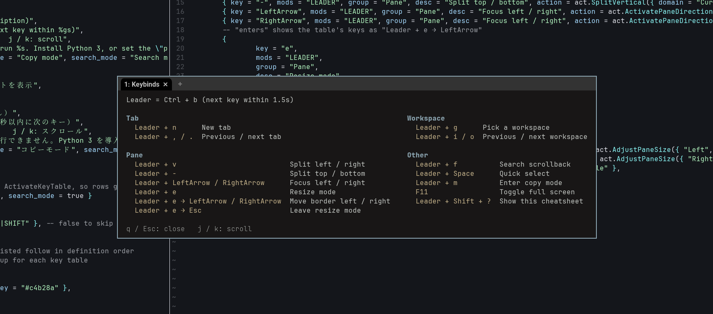

# wezterm-cheatsheet-window

[English](README.md)

WezTerm のキーバインドを**別の小窓**に表示します。
作業中のペインを分割したり覆ったりせずに読めます。



<sub>説明用のキーバインドで表示しています。青い枠線は撮影用に付けたもので、プラグインの機能ではありません。</sub>

- 自分の `config.keys` と `config.key_tables` から一覧を作成。`desc` を書き足せば、一覧が設定と一致し続けます
- 自作のキーテーブルも、入るためのキーと一緒に表示します（`Leader + e → LeftArrow`）
- 同じ説明のキーは1行にまとめます（`Leader + LeftArrow / RightArrow`）
- グループ分けした2列表示。日本語などの全角文字の幅にも対応します
- 定型の表示文言は英語と日本語に対応します

## 必要な環境

- WezTerm（nightly `20261114-121057-e1eae81a` で開発。他のバージョンは未確認）
- Python 3（`PATH` 上の `python3`、または `python` オプションで指定）。追加パッケージは不要です。
  3.12.3 で確認しています。実行できない場合は、エラーをログに記録して通知を出します。
- 対応状況:

| 環境 | 状況 |
|---|---|
| Linux、GNOME（Wayland）上で WezTerm を XWayland で実行（`enable_wayland = false`） | 確認済み |
| Linux、GNOME で WezTerm をネイティブ Wayland で実行 | プラグイン版は未確認 |
| その他の Linux デスクトップ | 未確認 |
| macOS | 未確認 |
| Windows | 非対応（ビューアが `termios` を使うため） |

## 導入

```lua
local cheatsheet = wezterm.plugin.require("https://github.com/YujiTsuruda/wezterm-cheatsheet-window")

-- ... config.leader、config.keys、config.key_tables を設定する ...

cheatsheet.apply_to_config(config, { lang = "ja" }) -- これらの設定より後に呼ぶ
```

`Leader + ?` で小窓が開きます。`q` か `Esc` で閉じ、`j` / `k` か矢印キーでスクロールします。
すでに開いている状態でもう一度押すと、その窓を前面に出すように WezTerm に要求します。

初期設定の呼び出しキーには `config.leader` が必要です。Leader を使わない場合は、`key` で別のキーを指定してください。

## キーに説明を付ける

`config.keys` と `config.key_tables` の各エントリに、次の項目を追加します。
これらの項目は、`apply_to_config` が設定から取り除きます。

| 項目 | 意味 |
|---|---|
| `desc` | 説明。グループと `desc` が同じ行は1行にまとめます |
| `group` | 表示する見出し |
| `enters` | `config.keys` のエントリに指定する、そのキーで有効になるキーテーブルの名前 |

`desc` がないキーも隠さず、「（説明なし）」として表示します。
`group` がない場合、`config.keys` のキーは「未分類」に、キーテーブル内のキーはテーブル名の見出しに入ります。
`copy_mode` と `search_mode` の見出しは「コピーモード」「検索モード」になります。

一覧に載るのは、自分で設定したキーだけです。WezTerm の標準キーバインドは載りません。

完全な設定例は [`examples/wezterm.lua`](examples/wezterm.lua) を参照してください。

## オプション

```lua
cheatsheet.apply_to_config(config, {
  key = { key = "?", mods = "LEADER|SHIFT" }, -- false: キーを追加しない
  lang = "en",                                -- "en" または "ja"（初期値は "en"）
  title = "Keybinds",                         -- 小窓のタイトル
  group_order = { "Pane", "Tab" },            -- 指定していないグループは定義順で後ろに並ぶ
  table_groups = { pane_size = "Pane" },    -- キーテーブルごとの既定グループ
  columns = 2,                                -- 1 または 2
  max_height = 50,                            -- 小窓の高さの上限（行数）
  colors = { heading = "#8ba4b0", key = "#c4b28a" },
  python = "python3",
})
```

`group_order` と `table_groups` の値は書き方の例で、初期値ではありません。

`apply_to_config` は、小窓を開くアクションを返します。`key = false` にすると、
あとから `config.keys` に追加して、好きなキーに割り当てられます。

```lua
local show = cheatsheet.apply_to_config(config, { key = false })
local keys = config.keys
table.insert(keys, { key = "F1", action = show })
config.keys = keys
```

## 注意点

- 小窓の位置は、ウィンドウマネージャーが決めます。GNOME では
  `gsettings set org.gnome.mutter center-new-windows true` で新しい窓を中央に表示できます
  （すべてのアプリに影響します）。
- 小窓は常に手前には表示されないため、他の窓を選ぶと隠れることがあります。
- 小窓にも `window_decorations` の設定が適用されます。確認した XWayland の環境では、`"RESIZE"` でも
  タイトルバーが表示され、`"NONE"` で消えました（`"NONE"` は WezTerm のすべての窓に影響し、
  窓の端をドラッグしたサイズ変更ができなくなる可能性があります）。
- `q` や `?` が反応しない場合は、日本語入力（IME）がオフになっているか確認してください。

## ライセンス

[MIT](LICENSE)
