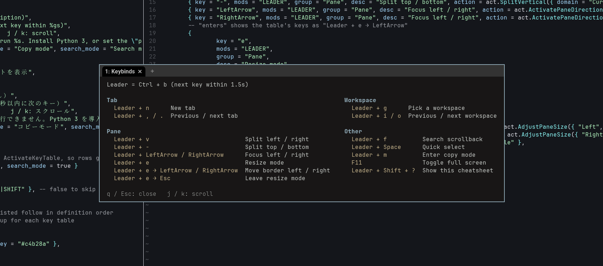

# wezterm-cheatsheet-window

[日本語](README.ja.md)

Show your WezTerm key bindings in a **separate small window**, so you can read them
without splitting or covering the pane you are working in.



<sub>Shown with demo key bindings. The blue border was added for this screenshot; the plugin does not draw it.</sub>

- Built from your own `config.keys` and `config.key_tables`: add `desc` and the list stays in sync
- Includes your custom key tables, shown with the key that enters them (`Leader + e → LeftArrow`)
- Rows with the same description are merged (`Leader + LeftArrow / RightArrow`)
- Grouped, two-column layout that accounts for wide (CJK) characters
- English and Japanese UI text

## Requirements

- WezTerm (developed on nightly `20261114-121057-e1eae81a`; other versions are untested)
- Python 3 (`python3` on `PATH`, or set the `python` option). No extra packages are needed.
  Tested with 3.12.3. If it cannot be run, the plugin shows the error over the current pane (press `Esc` to close it),
  logs it, and also sends a desktop notification, which may not appear.
- Platforms:

| Platform | Status |
|---|---|
| Linux, GNOME on Wayland, WezTerm on XWayland (`enable_wayland = false`) | Tested |
| Linux, GNOME, WezTerm on native Wayland | Tested with [`examples/wezterm.lua`](examples/wezterm.lua): open, close, no duplicate window |
| Other Linux desktops | Untested |
| macOS | Untested |
| Windows | Not supported (the viewer uses `termios`) |

## Setup

```lua
local cheatsheet = wezterm.plugin.require("https://github.com/YujiTsuruda/wezterm-cheatsheet-window")

-- ... set config.leader, config.keys and config.key_tables ...

cheatsheet.apply_to_config(config) -- call this after them
```

Press `Leader + ?` to open the window. Close it with `q` or `Esc`; scroll with `j` / `k` or the arrow keys.
If it is already open, pressing the key again asks WezTerm to focus it.

The default trigger needs `config.leader`. Without a leader, set `key` to another binding.

## Describing key bindings

Add these fields to entries in `config.keys` and `config.key_tables`.
They are removed from the config by `apply_to_config`.

| Field | Meaning |
|---|---|
| `desc` | Description. Rows with the same group and `desc` are merged. |
| `group` | Heading to list the binding under. |
| `enters` | On a binding in `config.keys`: the name of the key table it activates. |

Nothing is hidden: a binding without `desc` is listed as "(no description)".
Without `group`, bindings in `config.keys` go under "Ungrouped", and bindings in a key table
go under the table's name. `copy_mode` and `search_mode` use the headings "Copy mode" and
"Search mode".

Only bindings in your config are listed. WezTerm's default bindings are not.

See [`examples/wezterm.lua`](examples/wezterm.lua) for a complete example.

## Options

```lua
cheatsheet.apply_to_config(config, {
  key = { key = "?", mods = "LEADER|SHIFT" }, -- false: do not add a binding
  lang = "en",                                -- "en" or "ja"
  title = "Keybinds",                         -- window title
  group_order = { "Pane", "Tab" },            -- other groups follow in definition order
  table_groups = { pane_size = "Pane" },    -- default group per key table
  columns = 2,                                -- 1 or 2
  max_height = 50,                            -- maximum window height in rows
  colors = { heading = "#8ba4b0", key = "#c4b28a" },
  python = "python3",
})
```

`apply_to_config` returns the action that opens the window. With `key = false`,
you can bind it yourself by appending to `config.keys` afterwards:

```lua
local show = cheatsheet.apply_to_config(config, { key = false })
local keys = config.keys
table.insert(keys, { key = "F1", action = show })
config.keys = keys
```

## Notes

- The window position is chosen by your window manager. On GNOME, new windows can be centered with
  `gsettings set org.gnome.mutter center-new-windows true` (this affects all applications).
- The window is not kept on top, so focusing another window can hide it.
- The window uses your `window_decorations` setting. In the tested XWayland setup, `"RESIZE"` still showed
  a title bar; `"NONE"` removed it (this affects all WezTerm windows and may disable resizing by the edges).
- If `q` or `?` does not respond, check that your input method (IME) is off.

## License

[MIT](LICENSE)
